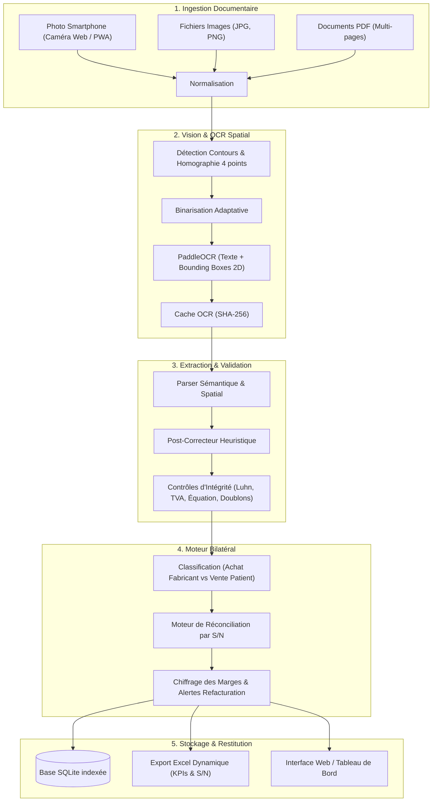

# ARGUS — Contrôle & Rapprochement de Factures (Audioprothèse)

[](https://www.python.org/)
[](https://fastapi.tiangolo.com/)
[](https://github.com/PaddlePaddle/PaddleOCR)
[](https://www.sqlite.org/)
[](https://github.com/Tacosknight/Projet-ARGUS)

> Solution locale, modulaire et déterministe (sans LLM) d'audit documentaire, d'extraction OCR avec géométrie spatiale 2D, et de réconciliation bilatérale des aides auditives par numéro de série (S/N).

---

## Vue d'Ensemble

Dans le secteur de l'audioprothèse, la gestion administrative repose sur un double flux documentaire : les **factures d'achats fabricants** (Phonak, Oticon, Signia, Widex, Starkey, GN ReSound, etc.) et les **factures de vente patients**. L'absence de réconciliation systématique engendre des pertes de marge, des oublis de refacturation d'appareils et des anomalies comptables.

**ARGUS** automatise intégralement cette chaîne de contrôle :
- **Audit comptable et légal** : Contrôle automatique du SIRET (Luhn), de la TVA intracommunautaire, de l'équilibre fiscal (HT + TVA = TTC) et détection des doublons.
- **Rapprochement bilatéral par Numéro de Série (S/N)** : Appariement automatique entre les appareils achetés aux fabricants et les appareils facturés aux patients, avec calcul instantané des marges brutes.
- **Traitement 100% local** : Aucune donnée médicale ou financière ne transite par le cloud. Fonctionne en circuit fermé pour une conformité totale au RGPD et au secret médical.

> [!NOTE]
> ARGUS n'utilise aucun modèle d'IA générative opaque (LLM). L'ensemble des décisions, calculs et extractions repose sur des règles déterministes, une géométrie cartésienne 2D et des algorithmes arithmétiques vérifiables.

---

## Fonctionnalités Clés

- **Ingestion Multiformat & Multi-pages** :
  - Prise en charge des photographies smartphone (JPG, PNG) et des documents PDF (vectoriels et numérisés multi-pages).
  - Découpage automatique des pages PDF et consolidation sous forme d'une pièce comptable unique.
- **Vision par Ordinateur & OCR Spatial 2D** :
  - Détection automatique des 4 sommets et redressement géométrique par homographie.
  - Binarisation adaptative supprimant les ombres et reflets de prise de vue.
  - Extraction PaddleOCR avec coordonnées spatiales et cache d'empreintes SHA-256 pour éviter les recalculs superflus.
- **Moteur de Parsing & Heuristiques Audioprothèse** :
  - Extraction robuste des ancres textuelles par recherche floue (`thefuzz`) tolérante aux coquilles optiques.
  - Détection fine des fabricants, des marques équivalentes (ex. Sonova/Phonak, Demant/Oticon) et des modèles d'aides auditives.
  - Filtre spécialisé pour isoler les numéros de série (S/N) authentiques et écarter les codes-barres ou références accessoires.
  - Module de post-correction optique rectifiant les confusions classiques (0/O, 1/I, virgules décimales).
- **Rapprochement Bilatéral & Matrice de Marges** :
  - Comparaison directe côte-à-côte (Fabricant vs Patient).
  - Surlignage sémantique :
    - Vert (Match) : Données conformes, S/N réconcilié, marge positive.
    - Orange (Warning) : Tolérance floue sur le modèle ou TVA reconstituée.
    - Rouge (Error) : Appareil non refacturé, vente à perte ou divergence arithmétique.
- **Lanceurs Autonomes & Interface Web Mobile-First** :
  - Scripts 1-clic pour Linux/macOS et Windows avec configuration automatique de l'environnement virtuel et ouverture du navigateur.
  - Script Windows dédié au traitement batch avec ouverture automatique du classeur Excel.
  - Affichage d'un QR Code dans le terminal pour connexion smartphone instantanée en Wi-Fi.
  - Déclenchement de la caméra mobile pour numériser directement les factures au comptoir.
  - Registre interactif avec modale d'édition manuelle des champs détectés.
- **Export Managérial Excel & Base SQLite** :
  - Génération dynamique d'un classeur multi-onglets (Tableau de bord KPIs, Audit des prothèses S/N, Détail des factures avec mise en forme conditionnelle).
  - Base SQLite locale persistante avec indexation optimisée.

---

## Architecture & Flux de Données



---

## Structure du Projet

```text
facture-checker/
├── core/
│   ├── preprocessor.py        # Détection contours, homographie 4 points et binarisation
│   ├── ocr_engine.py          # Moteur PaddleOCR et conversion PDF multi-pages
│   ├── ocr_cache.py           # Système de cache persistant des sorties OCR
│   ├── multipage.py           # Découpage, consolidation et fusion multi-pages
│   ├── parser.py              # Extraction champs, détection Achat/Vente et filtrage S/N
│   ├── post_corrector.py      # Correction heuristique post-OCR (chiffres, SIRET, dates)
│   ├── validator.py           # Contrôles d'intégrité (Luhn, TVA, équation fiscale, doublons)
│   ├── reconciliation.py      # Moteur de réconciliation des prothèses par S/N
│   └── comparator.py          # Comparateur bilatéral direct Fournisseur ↔ Client
│
├── storage/
│   ├── database.py            # Couche d'accès SQLite et indexation
│   └── export_excel.py        # Génération dynamique du rapport Excel avec styles conditionnels
│
├── web/
│   ├── app.py                 # API REST FastAPI et contrôleurs
│   └── templates/
│       └── index.html         # Interface Web réactive (Scanner, Comparateur, Registre)
│
├── tests/                     # Suite de tests unitaires et d'intégration
├── input_photos/              # Répertoire d'entrée par défaut pour les images
├── requirements.txt           # Dépendances Python épinglées
├── main.py                    # Point d'entrée principal (CLI batch et mode web)
├── server.py                  # Lanceur du serveur mobile avec QR Code terminal
├── lancer_serveur_linux.sh    # Lanceur 1-clic Linux / macOS (venv + serveur + navigateur)
├── lancer_serveur_windows.bat # Lanceur 1-clic Windows (détection Python + venv + navigateur)
└── traiter_dossier_batch.bat  # Lanceur 1-clic Windows pour audit batch + ouverture Excel
```

---

## Démarrage Rapide

### 1. Lancement 1-Clic

Des lanceurs automatisés permettent de démarrer l'application sans configuration manuelle préalable :

#### Interface Web & Scanner Mobile

- **Sous Linux / macOS** :
  ```bash
  chmod +x lancer_serveur_linux.sh
  ./lancer_serveur_linux.sh
  ```
  Le script prépare l'environnement virtuel (`venv`), installe les dépendances si nécessaire, démarre le serveur FastAPI et **ouvre automatiquement votre navigateur** sur `http://localhost:8000`.

- **Sous Windows** :
  Double-cliquez sur :
  ```cmd
  lancer_serveur_windows.bat
  ```
  Le script vérifie la présence de Python (via `python` ou le launcher `py -3`), redirige automatiquement vers le site officiel en cas d'absence, initialise le `venv`, met à jour `pip`, ouvre l'interface dans votre navigateur par défaut et affiche le QR Code dans la console.

#### Traitement par Lot 1-Clic (Windows)

Pour auditer d'un coup l'ensemble des documents placés dans le dossier `input_photos` :
- Double-cliquez sur :
  ```cmd
  traiter_dossier_batch.bat
  ```
  Ce script exécute l'analyse complète (contrôles légaux, extraction S/N, rapprochement), génère `factures_synthese.xlsx` et **ouvre immédiatement le fichier dans Microsoft Excel ou votre tableur par défaut**.

> [!TIP]
> Sur Linux ou macOS, l'équivalent en une ligne de commande s'exécute via :
> ```bash
> ./venv/bin/python3 main.py --input-dir input_photos --output-excel factures_synthese.xlsx && xdg-open factures_synthese.xlsx
> ```

---

### 2. Installation Manuelle

Si vous préférez gérer l'environnement à la main :

```bash
# Cloner le dépôt
git clone https://github.com/Tacosknight/Projet-ARGUS.git
cd Projet-ARGUS

# Créer et activer l'environnement virtuel
python3 -m venv venv
source venv/bin/activate  # Sur Windows : venv\Scripts\activate

# Installer les dépendances
pip install -r requirements.txt

# Démarrer le serveur avec QR Code
python server.py
```

---

### 3. Utilisation Mobile (Scanner Smartphone)

ARGUS intègre une interface pensée pour les smartphones connectés au réseau local du cabinet ou de la boutique :

```
┌────────────────────────────────────────┐
│  SERVEUR FASTAPI ACTIF                 │
│  URL Locale : http://192.168.1.42:8000 │
│  Scan QR Code pour ouvrir :            │
│  █████████████████████████████████     │
│  █████████████████████████████████     │
│  █████████████████████████████████     │
└────────────────────────────────────────┘
```

1. **Connectez votre smartphone** au même réseau Wi-Fi que l'ordinateur exécutant ARGUS.
2. **Scannez le QR Code** affiché dans votre terminal à l'aide de l'appareil photo du smartphone.
3. L'application Web s'ouvre directement :
   - Choisissez le mode de capture (caméra en direct ou sélection de fichiers/PDF).
   - Déposez la facture fabricant et la facture patient dans les zones dédiées.
   - Consultez le diagnostic instantané et téléchargez la synthèse Excel en un clic.

---

## Utilisation en Ligne de Commande (Batch)

Pour traiter un volume important de factures sans interface graphique :

### Traitement standard d'un dossier
```bash
python main.py --input-dir input_photos/ --output-excel factures_synthese.xlsx
```

### Options de la Ligne de Commande

| Option | Description | Valeur par défaut |
| :--- | :--- | :--- |
| `-h`, `--help` | Affiche l'aide et la liste des arguments | — |
| `--input-dir CHEMIN` | Répertoire source contenant les images ou PDF | `input_photos` |
| `--db-path CHEMIN` | Emplacement du fichier de base de données SQLite | `invoices.db` |
| `--output-excel CHEMIN` | Nom du rapport Excel généré | `factures_synthese.xlsx` |
| `--save-debug` | Enregistre les images redressées pour contrôle visuel | `False` |
| `--web` | Démarre le serveur web FastAPI | `False` |

### Génération d'un Jeu d'Essai
Pour valider l'ensemble des règles d'audit (facture conforme, erreur arithmétique, SIRET erroné, doublon, photo déformée) :
```bash
python generate_test_samples.py
```

---

## Référence de l'API REST

Le backend FastAPI expose les endpoints suivants :

| Méthode | Route | Description |
| :--- | :--- | :--- |
| `GET` | `/` | Interface utilisateur Web interactive |
| `POST` | `/api/scan` | Analyse et audit d'un ou plusieurs documents (images ou PDF) |
| `POST` | `/api/compare` | Rapprochement bilatéral direct (Facture Fabricant ↔ Facture Client) |
| `GET` | `/api/reconciliation` | Matrice globale de réconciliation par S/N et état des marges |
| `GET` | `/api/invoices` | Liste exhaustive des factures auditées en base |
| `GET` | `/api/invoices/{id}` | Détail complet d'une facture par son identifiant |
| `PUT` | `/api/invoices/{id}` | Mise à jour manuelle des métadonnées (montants, SIRET, S/N) |
| `DELETE` | `/api/invoices/{id}` | Suppression d'une facture spécifique |
| `DELETE` | `/api/invoices` | Réinitialisation complète de la base de données |
| `GET` | `/api/export` | Téléchargement du classeur Excel de synthèse |
| `GET` | `/api/kpi` | Indicateurs clés de performance et statistiques de conformité |

---

## Règles d'Audit & Algorithmes de Contrôle

Chaque facture ingérée est soumise à quatre vérifications indépendantes :

1. **Validation Légale** :
   - **SIRET / SIREN** : Contrôle de la clé de conformité par l'**algorithme de Luhn**.
   - **TVA Intracommunautaire (France)** : Vérification de la clé algorithmique :
     $$\text{Clé} = [12 + 3 \times (\text{SIREN} \pmod{97})] \pmod{97}$$
2. **Équilibre Arithmétique** :
   - Vérification de l'équation fiscale avec tolérance d'arrondi monétaire :
     $$|\text{Total HT} + \text{Montant TVA} - \text{Total TTC}| \le 0{,}02\text{ €}$$
3. **Contrôle Chronologique** :
   - Vérification de cohérence garantissant que la date d'émission ne se situe pas dans le futur.
4. **Détection des Doublons (Anti-Fraude)** :
   - Calcul d'une empreinte cryptographique unique **SHA-256** combinant :
     $$\text{Hash} = \mathcal{H}(\text{SIRET} \parallel \text{Date} \parallel \text{Numéro Facture} \parallel \text{Montant TTC})$$

> [!IMPORTANT]
> Tout document présentant une discordance se voit attribuer un statut explicite (`VALIDE`, `ERREUR_CALCUL`, `SIRET_INVALIDE`, `DOUBLON`, `A_VERIFIER`), accompagné d'un journal des anomalies consultable dans l'interface et dans le rapport Excel.
